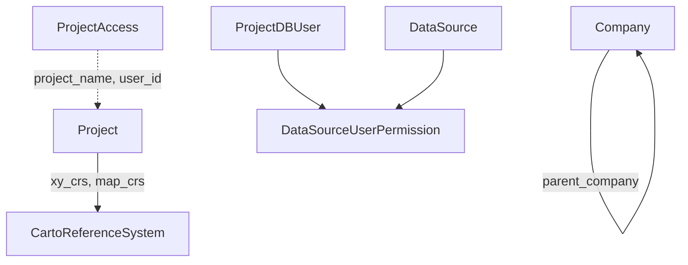

# Project & Reference Data

The scaffolding everything else hangs from: which project you're in, who can see what, which coordinate systems exist, and the controlled vocabularies used by well data. Almost all of it is **read-only** through this model.

## Project and access

- **Project** — one OpenWorks project: its type, leader, measurement system, district, area extent (`min_x..max_y` + `spatial` polygon), and two CRSs: `xy_crs` (storage) and `map_crs` (display). Read-only.
- **ProjectAccess** — which user can open which project and at what `security_level`.
- **ProjectDBUser** — the database users known to the project.
- **DataSourceUserPermission** — per-user security level on each **DataSource**.

## DataSource

**DataSource** is the interpreter / version tag (`name`, `type`, `public_ind`). Nearly every interpreted object points to one, which is how several interpretations of the same horizon, fault or pick coexist. This is one of the few reference entities you can create, rename and delete.

## Coordinate reference systems

**CartoReferenceSystem** lists the CRSs available in the project: projection type, datum and shift options, EPSG code, and a `basis_geographic_name` link to its underlying geographic CRS. Read-only — any entity with a `crs` column must name one of these.

## Companies

**Company** holds operators, contractors and acquisition companies, with an optional `parent_company` hierarchy. It's referenced as `current_operator` on **Well**, `contractor` on cores and TD tables, `acquired_by` on seismic surveys, and so on. Read-only.

## Controlled vocabularies (`Ref*`)

Pick lists that well data validates against. All writable.

| Entity | Used by | Contents |
|---|---|---|
| **RefPickSurfaceName** | `Pick.pick_name` | Formation top / surface names with abbreviation and alias |
| **RefStratigraphicUnitName** | `GeoShapeSet.geo_name`, `WellCore.primary_core_form` | Stratigraphic unit names |
| **RefLogCurveName** | `LogCurve.log_curve_name` | Curve mnemonics with unit type, curve type, API code |
| **RefLoggingService** | `WellLog.log_name` | Logging service (tool) names per company |
| **RefWellboreStatus** | `WellCore.well_status_name` | Status names, abbreviations and map symbols |
| **RefLithoClass** | core descriptions | Lithology classes with symbol and fore/background colours |
| **RefCoreAnalysisType**, **RefCoreProperty** | core analysis | Analysis types and measured property names |

Most reference rows carry `ref_value_source` / `ref_value_status` to show where the value came from and whether it is approved.
