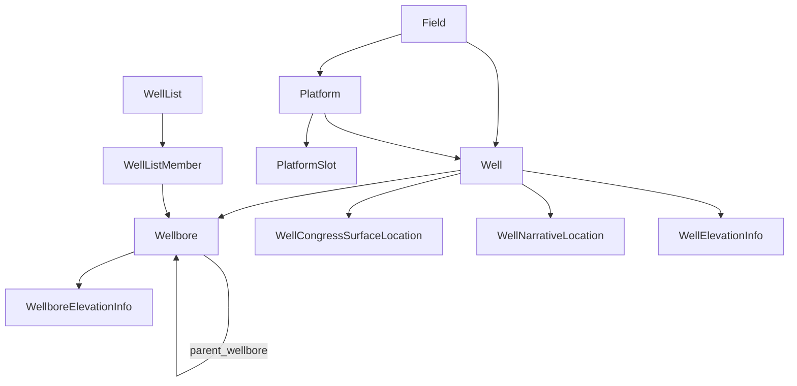

# Wells

## Well vs Wellbore

- **Well** is the *surface location*: one hole in the ground (or one slot on a platform). It holds the UWI, name, operator, field, country/state/county, surface x/y + CRS, ground elevation, water depth and on/offshore flag. `surface_location_point` is the derived map point.
- **Wellbore** is *a path drilled from that well*. A well with a sidetrack has two wellbores; `parent_wellbore_native_uid` links a sidetrack to the bore it kicked off from (with `kick_off_depth`/`kick_off_tvd`). The wellbore holds everything about the drilled hole: bottom-hole location (`bh_x/y_coordinate`, `bh_location_point`), total depth, plugged-back depth, class and status, spud/completion dates, permits, costs, drilling operator, formation at TD.

Nearly all downhole data (surveys, logs, picks, cores, time-depth tables) attaches to the **Wellbore**, not the Well.

## Fields and platforms

- **Field** — a field *or prospect* (`field_prospect_ind`). Holds reservoir and fluid info, discovery date and well, operator, play/trend, distance to shore/pipeline/facility, development cost estimates, and — for prospects — planned drill year and probability. `nearest_discovery` links to another Field.
- **Platform** — an offshore structure: code, operator company, field, block, water depth, location.
- **PlatformSlot** — a drilling slot on a platform, with x/y offset from the platform reference. Wells reference their platform and slot number.

## Location and elevation detail

- **WellCongressSurfaceLocation** — US Public Land Survey description: meridian, township, range, section, lot and footages from section lines.
- **WellNarrativeLocation** — free-text location descriptions, ordered by `sequence_no`.
- **WellElevationInfo** (read-only) / **WellboreElevationInfo** — the named elevation references (KB, DF, GL…) per rig, as value + unit. Logs and surveys refer to these by name.

## Well lists

- **WellList** — a named, saved selection of wells (insert only).
- **WellListMember** — the wellbores in a list, with an `order`.

## Things to know

- `well_uwi` is unique per Well; `wellbore_uwi` is unique per Wellbore.
- `basin_name`, `county_name`, `country_name`, `state_name`, `current_operator` default to `'UNKNOWN'`.
- Setting `crs` on insert/update must name a CRS OpenWorks knows (see [Conventions](conventions.md#coordinates-crs-and-z-domain)).
