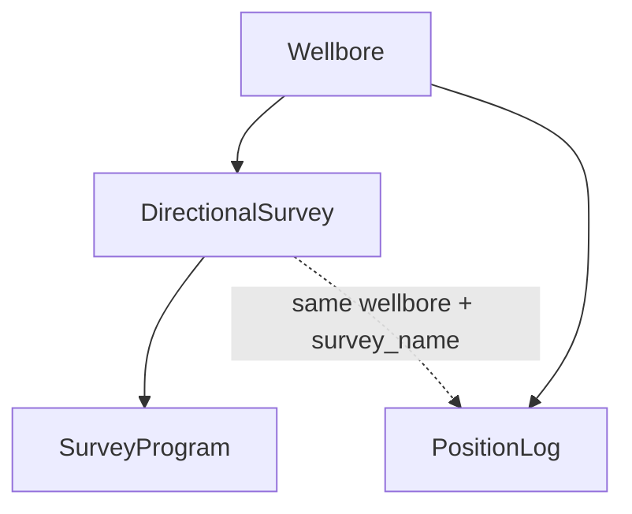

# Trajectories

Where the wellbore actually goes underground.

## DirectionalSurvey — the measured stations

The raw survey: measured depth, inclination and azimuth at each station, plus the computed TVD and x/y offsets from the wellhead, and — for uncertainty work — x/y/z bias and the six covariance terms. All of that lives as arrays in `data`, with one unit column per quantity (`md_unit`, `azimuth_unit`, …).

Header fields describe *how* it was surveyed: method, tool, calculation method, single/multi-shot, north reference, convergence angle, survey company/engineer/date, and the **tie-in point** (`tie_pt_md`, `tie_pt_tvd`, offsets, initial azimuth/inclination). A sidetrack's survey can tie onto another wellbore's survey via `tie_on_survey_native_uid` / `tie_on_wellbore_native_uid`.

A wellbore can have several surveys; `preferred_survey_ind` marks the definitive one.

## SurveyProgram — which tool, which interval

Ordered list of survey tools used over depth intervals (`sequence_no`, `tool_name`, `top_depth`, `base_depth`). Needed for position-uncertainty calculations because each tool has its own error model.

## PositionLog — the computed path

The resampled, computed trajectory: md, tvd, x_offset, y_offset arrays in `data`, plus the bottom-hole position (`bh_md`, `bh_z`, `bh_x/y_offset`). Linked to its source survey by `(wellbore_native_uid, survey_name)`. `time_depth_ind` flags whether it's in time or depth.

Use **PositionLog** when you just need "where is the wellbore at MD x"; use **DirectionalSurvey** when you need the raw stations or uncertainty.

The `ComputeDeviationFromWellhead(poslog_native_uid)` procedure returns deviation data computed from a position log.
