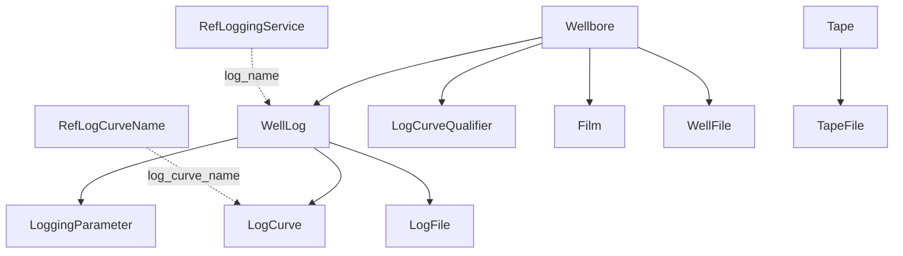

# Well Logs & Files

## WellLog — one logging pass

A **WellLog** is a single logging run/pass of a service in a wellbore, identified by `log_name` (service, FK → **RefLoggingService**), `log_run_no`, `log_pass_id` and `log_version`. It records the logging company, run date, elevation reference, depth range (`index_min`/`index_max`), pass direction and speed, max recorded temperature and cost.

## LogCurve — the measurements

Each **LogCurve** is one curve (GR, RHOB, DT…) from a WellLog, named by `log_curve_name` (FK → **RefLogCurveName**). The header gives index range and increment, sample count, min/max value, null value (`no_data_value`), unit and unit type, and dimensionality (`number_of_dimensions`, `second_dimension_pts` for array logs). The `data` payload is a pair of arrays: `depths` and `values`.

Bulk curve writes can go through the `LogCurveWriteProtoBuf(logCurveId, start_index, length, data)` procedure.

## LoggingParameter

Named numeric or string parameters for a log pass — mud resistivity, bit size, matrix density, etc. — with unit and unit type.

## LogCurveQualifier (read-only)

Qualifier tags attached to curves by service/run/pass/curve/version.

## Files and archives (read-only)

These come from the file/Recall store rather than OpenWorks tables, and expose the original file content as a `file_stream` BLOB plus descriptive and security metadata:

| Entity | What it is |
|---|---|
| **LogFile** | An original log file (LAS/DLIS…) attached to a WellLog |
| **Film** | A scanned log print (raster log) for a wellbore, with depth range |
| **WellFile** | Any other document attached to a wellbore |
| **Tape** / **TapeFile** | Archived log tapes and the files on them; TapeFile carries a large set of log header values (mud properties, Rm/Rmf/Rw, temperatures, TDs, tool string) |
