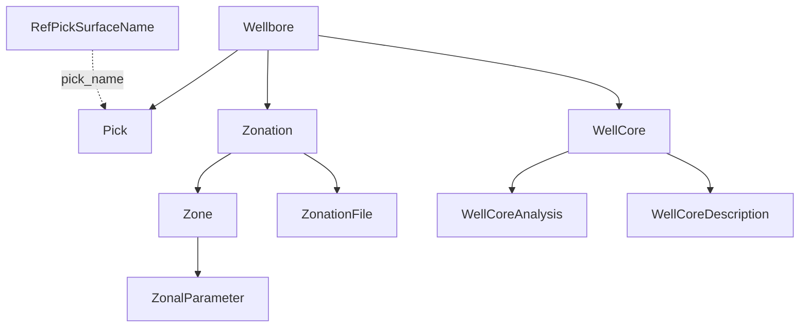

# Geology at Wells

Interpretations and samples tied to depths in a wellbore.

## Pick — formation tops

A **Pick** marks where a surface (from **RefPickSurfaceName**) crosses a wellbore: `pick_depth` (MD) with optional `min_depth`/`max_depth` range, dip and dip azimuth, kind, qualifier, confidence and source. The same surface can be picked more than once in a wellbore (`pick_obs_no`) and by different interpreters (`pick_by` = DataSource). Five free text and three numeric user-defined fields are available.

Picks are the bridge between well data and seismic/map interpretation: they tie horizons to wells and constrain surface grids.

## Zonation and Zone (read-only)

A **Zonation** is a named scheme that divides a wellbore into intervals (with hierarchy fields for nested schemes). Each **Zone** is one interval with `top_depth`/`bottom_depth`. **ZonalParameter** holds values computed per zone (e.g. average porosity), and **ZonationFile** the original file. These come from the file/Recall store.

## Cores

- **WellCore** — one core run: depth interval, core type (conventional vs sidewall via `sidewall_ind`), diameter and barrel size, recovery, contractor, coring fluid, orientation, costs and timings. For sidewall cores: shots planned, recovered, misfired, lost, empty.
- **WellCoreAnalysis** — lab results for a core: company, date, sample shape and size, and a `data` payload of per-sample arrays — porosity (helium, effective), permeabilities (kvert, kmax, k90, Klinkenberg-corrected), fluid saturations, grain/bulk density, resistivity, confining pressures and more. Its `native_uid` is composite (see [Conventions](conventions.md#identifiers)).
- **WellCoreDescription** — the geologist's description per interval: lithology class, porosity type and quality, shows, dip and free-text lithology description.

Reference lists: **RefCoreAnalysisType**, **RefCoreProperty**, **RefLithoClass**.
