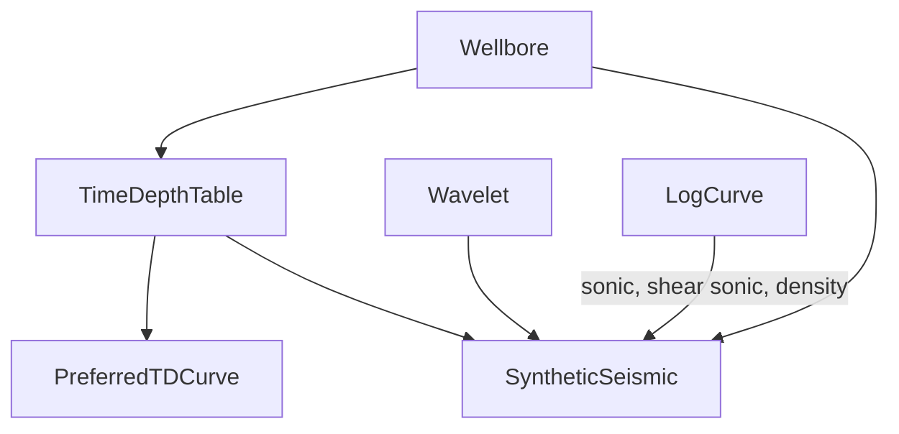

# Well–Seismic Tie

Converting between well depth and seismic two-way time.

## TimeDepthTable

The depth↔time relationship for a wellbore: arrays of md, time, depth (and x/y offsets) in `data`. The header tells you where it came from — `checkshot_flag`, survey type and direction (e.g. checkshot, VSP), source position and depth, contractor, a bulk `shift_value`, datum, and whether it has been corrected (`corrected_ind`).

## PreferredTDCurve

A wellbore can have many TD tables. **PreferredTDCurve** chooses which one to use, with separate `time_priority` and `depth_priority`. Applications that convert well data to time (picks, logs) consult this.

## Wavelet

The seismic pulse used for modelling: sampled `amplitude` array with sample interval and time-zero sample, plus descriptive stats (dominant period/wavelength, peak amplitude and frequency) and the filter that produced it (low/high cut and slopes, algorithm).

## SyntheticSeismic

A modelled seismic trace at a wellbore built from a sonic (and optionally shear sonic) and density **LogCurve**, a **TimeDepthTable** and a **Wavelet**. Stores the `amplitude` trace, time range, sample interval and offset (for angle/offset synthetics). Comparing it with real seismic at the well is how interpreters confirm which reflector is which formation.
