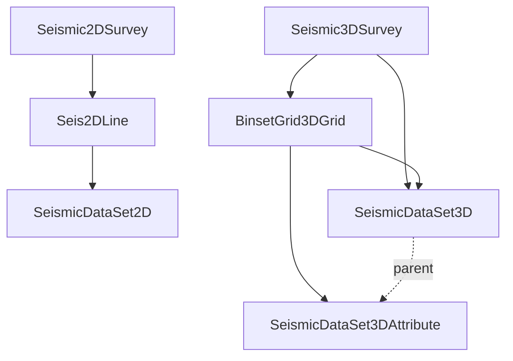

# Seismic

Survey geometry and the trace data recorded on it.

## Surveys

**Seismic2DSurvey** and **Seismic3DSurvey** describe an acquisition: who acquired it and for whom (**Company**), dates, cost, land/marine environment, area, crew, and misclosure factors. 3D surveys add source/channel/surface-location ranges and a vertical datum. 2D surveys can't be deleted through the model.

## Geometry

- **Seis2DLine** — one 2D line within a survey. Its shape is stored as shotpoint arrays: `shotpoints` (shotpoint → x, y), `orig_shotpoints` (as loaded, in their original CRS) and `mappings` (shotpoint → trace number). Also holds trace ranges, bounding boxes and a `spatial` line for maps.
- **BinsetGrid3DGrid** — the bin grid of a 3D survey: grid size (`grid_isize` × `grid_jsize`), inline/crossline numbers at the corners, corner x/y in project CRS, lat/lon and original CRS, offset and CDP binning. This is what turns (inline, xline) into (x, y).

## Seismic volumes

- **SeismicDataSet2D** — a processed seismic dataset on one 2D line.
- **SeismicDataSet3D** — a processed 3D volume on a bin grid, with inline/xline range and increment.
- **SeismicDataSet3DAttribute** — a volume derived from another (`parent_seismic_data_set_native_uid`), e.g. coherence or amplitude attributes.

All three share: version name, attribute name, class, amplitude range and unit, polarity, processing company/date, file name/format/size, and the z axis — `z_domain`, `z_start`, `z_sample_rate`, `z_npts` (with "actual" variants for trimmed data).

The trace data itself is in files; use `LocateSeismicFile`, `SeismicFilesSize` and `GetSeismicMountInformation` procedures to find them.
