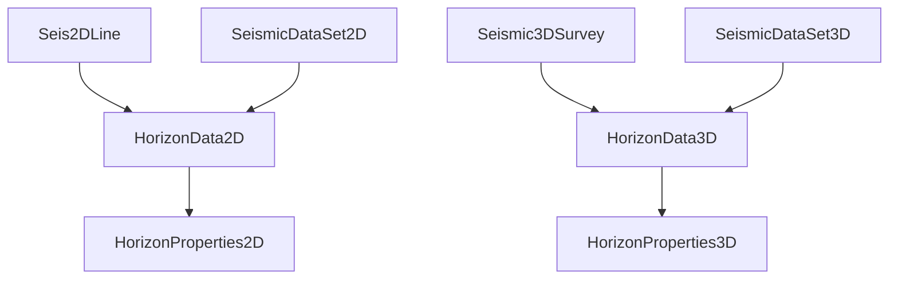

# Horizons

Interpreted seismic reflectors — the main product of seismic interpretation.

## HorizonData2D / HorizonData3D

A horizon is identified by `horizon_name`, `horizon_attribute_name` (usually time or depth of the pick), `data_source` and `interpretation_version_name`.

- **HorizonData3D** covers a 3D survey: one value per (inline, xline) bin.
- **HorizonData2D** covers one 2D line: one value per trace.

Both store the values as a float array in `data`, plus statistics (`horizon_min`/`max`/`mean`, trace range, `percent_coverage`, `total_samples`), the z domain and datum, how the event was picked (`seis_pick_onset`: peak, trough, zero-crossing…), the `pick_surface_name` it represents, and display style (line style, weight, RGB colour).

For large 3D horizons, read a sub-area with the `HorizonData3DRead(native_uid, start_line, start_trace, end_line, end_trace)` procedure (and `HorizonData2DRead` for 2D).

## HorizonProperties2D / HorizonProperties3D

Attributes computed *along* a horizon — amplitude, dip, azimuth, isochron — linked to the source horizon via `parent_horizon_id`. Same layout as the horizon itself.
