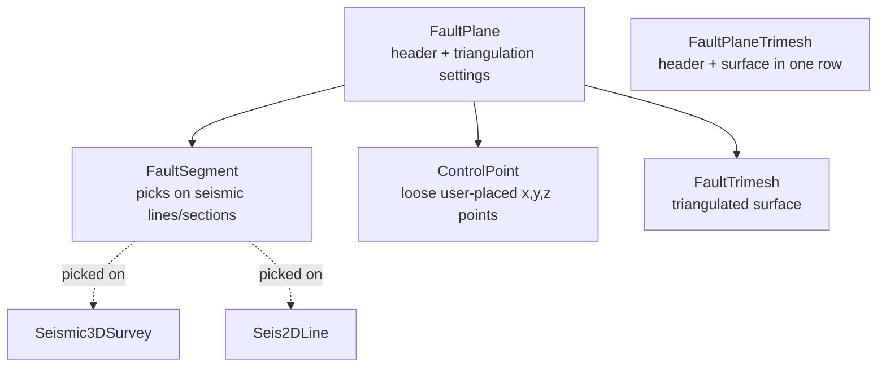

# Faults

## FaultPlane — the fault interpretation

**FaultPlane** is the header for one interpretation of a fault: `fault_name`, interpreter (`data_source`), `interpretation_version_name` and status, z domain, CRS, and `enable_triangulation`. `segment_modification_date` tells you when the picks last changed — compare it with the trimesh date to see if the surface is stale.

## FaultSegment — picks on seismic

Each **FaultSegment** is a polyline the interpreter picked on one seismic section: an inline/crossline/arbitrary line of a **Seismic3DSurvey**, or a **Seis2DLine**. The points are x[], y[], z[] arrays in `data`, with bounding box and z range. Segments are the primary evidence for the fault; most of a fault plane is built from them.

## ControlPoint — extra points by hand

**ControlPoint** holds single (x, y, z) points that are not tied to any seismic section (no survey or line fields, just coordinates, `z_domain` and CRS). An interpreter adds them by hand to shape the surface where segment data is missing or poor:

- to fill gaps between widely spaced picked lines
- to extend the fault beyond the seismic coverage, for example deeper or towards the fault tips
- to fix poor triangulation, such as stretched triangles or crossings
- to add a fault cut from a well or a geological idea where the seismic is ambiguous

Control points can be created and updated through the model, but not deleted.

## Triangulated surfaces (read-only)

The fault surface built from segments and control points is a triangle mesh:

- `vertices` — x[], y[], z[] arrays
- `triangles` — three index arrays (`vertex_1`, `vertex_2`, `vertex_3`) into the vertex list

**FaultTrimesh** is the mesh alone, linked to its FaultPlane. **FaultPlaneTrimesh** is a convenience view that joins the FaultPlane header with its mesh, bounding box and vertex/triangle counts in one row. Both are read-only: change the segments or control points and let the application re-triangulate.

## Faults on maps

Fault traces on horizon maps are stored separately as **MappingPolygon** rows (fault polygons with throw direction) — see [Maps & surfaces](10-maps-and-surfaces.md).

> `fault_name` references a **Fault** entity that is not defined in this DDL version.
