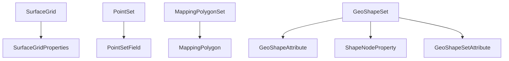

# Maps & Surfaces

Mapped results: gridded surfaces, scattered points, polygons and geological shapes. Most of these are in map (x, y) space, independent of any seismic survey.

## Which one do I need?

| You have… | Use |
|---|---|
| A regular gridded surface (structure, isopach, property map) | **SurfaceGrid** |
| Scattered x, y, z(, more) points — e.g. well tops, digitized contours | **PointSet** |
| Fault polygons or closed outlines drawn on a map | **MappingPolygon** |
| Geological bodies or outlines with per-shape and per-node attributes | **GeoShapeSet** |

## SurfaceGrid

A regular, optionally rotated grid: origin and extent (`x_min..y_max`), cell size (`grid_interval_x/y`), `num_cols` × `num_rows`, rotation, z domain and unit, null value, and the values themselves in `data_values`. `geo_name` / `geo_type` / `attribute` / `geologic_feature` say what it represents. **SurfaceGridProperties** are grids derived from a parent grid; **SurfaceGridExtendedProperties** exposes extra metadata (read-only).

## PointSet and PointSetField

A **PointSet** is a table of scattered points (`num_points`, bounding box, z domain, CRS) whose x/y/z are in `data`. Additional columns are **PointSetField** rows — each one a named field with its data type, unit, range and display format, and its own `data` array. Use the `GetXYPointSetBlob(pointSetID, fieldType)` procedure to fetch coordinate arrays.

## MappingPolygonSet and MappingPolygon

A **MappingPolygonSet** groups polygons drawn on one surface (`surface_name`). Each **MappingPolygon** is one polygon or polyline: point arrays (x, y, z, and `throw_direction` for fault polygons), area, colour, an optional constant `poly_z_value`, and the `fault` it belongs to. Fault polygons are how faults appear on horizon maps.

## GeoShapeSet and its attributes

A **GeoShapeSet** is a set of geological shapes (e.g. depositional outlines) tied to a stratigraphic unit (`geo_name` → **RefStratigraphicUnitName**), basin, field, play and pool. It stores nodes and shapes as arrays. Attributes come at three levels:

- **GeoShapeSetAttribute** — one value for the whole set
- **GeoShapeAttribute** — one value per shape
- **ShapeNodeProperty** — one value per node
