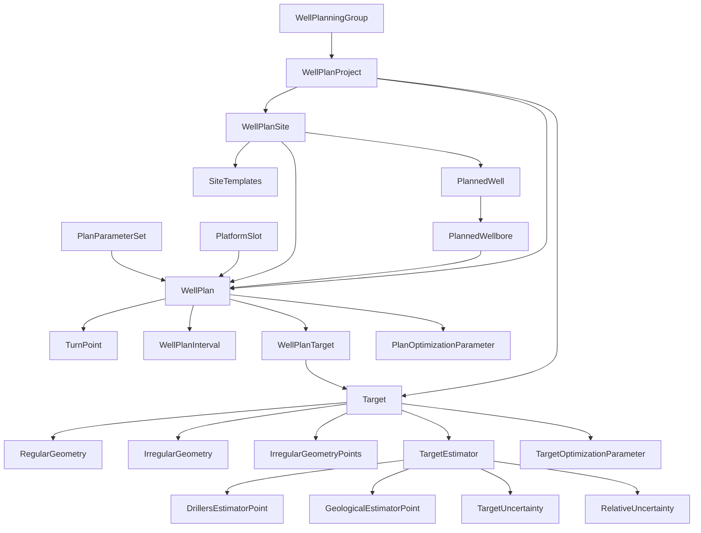

# Well Planning

The largest domain: designing new wells from targets to drillable trajectories. It has its own project hierarchy, separate from the OpenWorks **Project**.

## Organisation

- **WellPlanningGroup** — top-level grouping of planning projects.
- **WellPlanProject** — a planning project with its own area and CRS, start/end dates.
- **WellPlanSite** — a surface location (pad, platform, or drill centre) with a tie point. **SiteTemplates** describe the slot layout on a site: rows × columns, spacing, orientation, naming scheme.
- **PlannedWell** / **PlannedWellbore** — the wells and wellbores being designed, before they exist as real **Well**/**Wellbore** rows. A planned wellbore can branch from another (`parent_plannedwellbore_native_uid`).

## Targets — where the well must go

A **Target** is a point in the subsurface (`target_x/y/z`, optional `target_time`) with a type and the geological feature it aims for. Its shape is described by one of:

- **RegularGeometry** — a simple shape (circle, ellipse, rectangle) with orientation, radii, up/down thickness, dip and azimuth.
- **IrregularGeometry** + **IrregularGeometryPoints** — a polygon outline (sequence of x, y points) with thickness, dip and azimuth.
- **PolyTarget** (read-only) — a polygon target in a single row with its point data.

**TargetOptimizationParameter** holds named tuning parameters per target.

## Target uncertainty

How sure are we that the well will hit the target?

- **TargetEstimator** — settings for the hit-probability calculation: calculation and intersection modes, driller's intersection (u, v), geological pick uncertainty, and expected well azimuth/inclination at the target.
- **DrillersEstimatorPoint** — corner points (u, v) of the driller's target.
- **GeologicalEstimatorPoint** — boundary points with pick uncertainty, tolerance risk and hard-line flag.
- **TargetUncertainty** — the full uncertainty model: geophysical covariance (where the target really is) and survey covariance (where the well really is), correlation lengths, ellipsoid axes, steering box, and flags for which components to include.
- **RelativeUncertainty** — declares two target estimators whose uncertainties are correlated (e.g. two targets on the same horizon). Insert/delete only.

## WellPlan — the trajectory design

A **WellPlan** is a versioned design (`well_plan_name` + `well_plan_version`) for a planned wellbore, starting from a site, platform slot or parent wellbore (tie point x/y/z/md). It references a **PlanParameterSet** and carries design constraints (input dogleg severity, hole extension).

- **TurnPoint** — the ordered points that define the trajectory: md, inclination, azimuth, build/turn rate, dogleg severity, tool face, x/y/z, and the target it hits if any.
- **WellPlanTarget** — ordered list of targets the plan must hit, with status.
- **WellPlanInterval** — depth intervals along the plan (casing sections, formations, hazards) with free text.
- **PlanOptimizationParameter** — named optimization parameters per plan.

Use the `convertWellPlanToTargetCRS(native_uid, cartosystem, measurementsystem)` procedure to export a plan in another CRS/unit system.

## Concepts and helper views (read-only)

- **Concepts**, **ConceptPlans**, **ConceptSites**, **ConceptSiteOutlines**, **ConceptTargets** — development scenarios (stored as application data) that group targets, sites and plans for comparison.
- **plannedwellslots**, **tmpwellplanview**, **wellplanlocation**, **WellPlanSiteInfo** — internal helper views (slots, locations, site cost/day rate). No primary keys; not intended for direct use.
