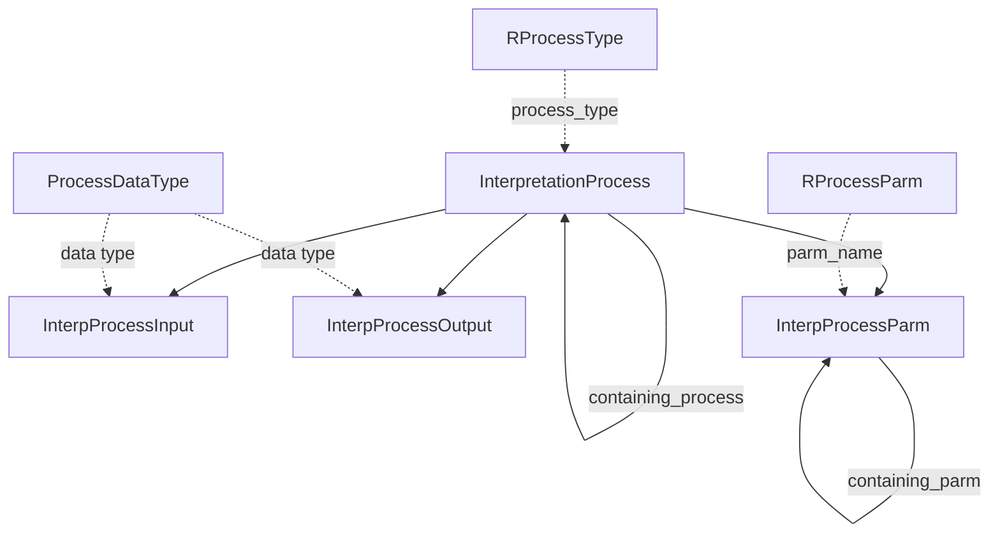

# Provenance & Annotations

How data was produced, notes about it, and application-private storage.

## Interpretation processes — lineage

**InterpretationProcess** records that an application ran a process (gridding, depth conversion, attribute extraction…): type (from **RProcessType**), name, start/end time, application and version. Processes can be nested (`containing_process_id`).

- **InterpProcessInput** / **InterpProcessOutput** — the data objects consumed and produced. Each is identified generically: a `*_data_type` from **ProcessDataType** plus up to eight key name/value pairs (**ProcessDataType** defines which keys identify each type).
- **InterpProcessParm** — parameters used, numeric (with unit) or string, which can be nested for structured parameters. Names come from **RProcessParm**.

Together these let you answer "which inputs and settings produced this grid?".

## INoteSummary — sticky notes

An **INoteSummary** is an annotation placed in the project: title, category, the object it relates to (`related_obj_type`/`related_obj_id`), effective date and geologic age range, a location in x/y/z, the note text, optional markup geometry, and display styling (box size, colours, opacity, symbol).

## ApplicationData / ApplicationData2

A key–value store for applications: `application_name`, `data_category`, `data_set_name` and an opaque `data` BLOB. Applications use it for settings and objects that have no dedicated entity (well-planning **Concepts** are stored here). The two views expose the same native table.
