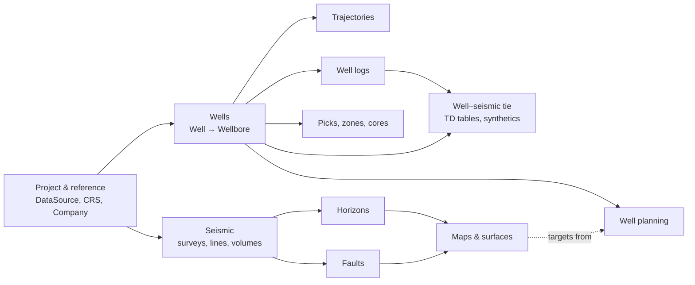

# OpenWorks Common Model – User Guide

A plain-language guide to the 119 entities of the OpenWorks Common Model (DSIS), grouped by what they mean to a geoscientist or developer rather than by table.

For column-level detail (types, keys, source mappings), see the generated reference [common-model-ddl-metadata.md](../../common-model-ddl-metadata.md), produced by `scripts/extract_ddl_metadata.py`.

## Domains

| # | Guide | What it covers |
|---|---|---|
| 0 | [Conventions](conventions.md) | Identifiers, units, CRS and z-domain, read-only columns, binary payloads, what you can write |
| 1 | [Project & reference data](01-project-and-reference.md) | Projects, data sources, users, CRS, companies, pick lists |
| 2 | [Wells](02-wells.md) | Well, Wellbore, Field, Platform, locations, elevations, well lists |
| 3 | [Trajectories](03-trajectories.md) | Directional surveys, survey programs, position logs |
| 4 | [Well logs & files](04-well-logs.md) | Log runs, curves, logging parameters, log/film/tape files |
| 5 | [Geology at wells](05-geology-at-wells.md) | Picks, zonations and zones, cores and core analysis |
| 6 | [Well–seismic tie](06-well-seismic-tie.md) | Time-depth tables, wavelets, synthetics |
| 7 | [Seismic](07-seismic.md) | 2D/3D surveys, lines, bin grids, seismic volumes |
| 8 | [Horizons](08-horizons.md) | 2D/3D horizon interpretation and derived attributes |
| 9 | [Faults](09-faults.md) | Fault planes, segments, control points, triangulated surfaces |
| 10 | [Maps & surfaces](10-maps-and-surfaces.md) | Grids, point sets, polygons, geo-shapes |
| 11 | [Well planning](11-well-planning.md) | Planning projects, sites, targets, plans, turn points, uncertainty |
| 12 | [Provenance & annotations](12-provenance-and-annotations.md) | Interpretation processes, notes, application data |

## How the domains connect

The **Wellbore** is the hub of all well data: trajectories, logs, picks, cores and time-depth tables hang off it. **DataSource** (the interpreter/version tag) and **CartoReferenceSystem** (CRS) are referenced almost everywhere.
